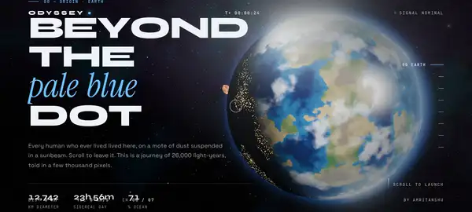

<h1 align="center">ODYSSEY</h1>
<p align="center"><b>Beyond the pale blue dot.</b> A scroll-driven 3D journey from Earth to the event horizon of Sagittarius A*.</p>
<p align="center"><a href="https://odyssey-sable-nine.vercel.app"></a></p>

<a href="https://odyssey-sable-nine.vercel.app"></a>

## The idea
Your scrollbar is the throttle. One unbroken camera flight carries you through eight chapters, with no hard cuts, and ends at a real-time ray-marched black hole.

| # | Chapter | Signature visual |
|:--:|:--|:--|
| 00 | Earth | Procedural continents, specular oceans, city lights on the night side, atmospheric rim glow |
| 01 | Moon | Harsh terminator, maria and crater noise |
| 02 | Mars | Rust terrain, polar cap, thin dusty atmosphere |
| 03 | Asteroid Belt | ~1,800 instanced rocks the camera flies *through* |
| 04 | Jupiter | Turbulent bands and the Great Red Spot |
| 05 | Saturn | Rings with the Cassini division and the planet's shadow |
| 06 | Sagittarius A* | Full-screen gravitational lensing and a Doppler-beamed accretion disk |
| 07 | Beyond | Outro, and a dive back toward the photon ring |

## Highlights
- **Zero image textures.** Every planet is built in GLSL shaders.
- **Speed you can feel.** Scroll faster for warp streaks, an FOV kick, camera roll and chromatic aberration.
- **Live HUD.** Mission clock, distance from Earth (switching from km to light-years), velocity and the current chapter.
- **Chapter rail.** Click a chapter and the camera flies there.
- **Accessible.** Real text rather than canvas, and `prefers-reduced-motion` turns off smoothing, warp and aberration.

## Built with
Three.js · GLSL · GSAP ScrollTrigger · Lenis. Plain HTML, CSS and JS modules, with no build step.

## Run it locally
```bash
python3 -m http.server 8000   # then open http://localhost:8000
```
Product and design notes live in [`PRD.md`](PRD.md) and [`UI.md`](UI.md).

<p align="center"><sub>Built by <a href="https://github.com/Amritanshu-nirjhar">Amritanshu Nirjhar</a> · more at the <a href="https://amritanshu-portfolio-beryl.vercel.app">portfolio ↗</a></sub></p>
